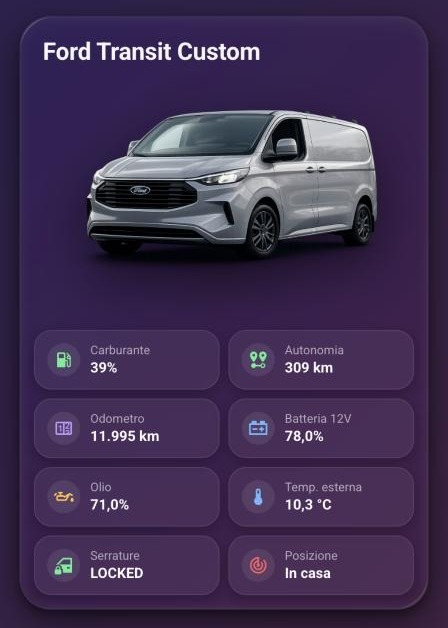

# FordPass Card

[](https://hacs.xyz)
[](https://github.com/Minny94/fordpass-card/actions/workflows/validate.yml)

A Lovelace card for Home Assistant built for the [FordPass integration](https://github.com/marq24/ha-fordpass) by marq24.
It finds your vehicle on its own, lets you pick which sensors to show from a list, and swaps the picture when a door is open.



> 🇮🇹 [Leggi in italiano](#italiano)

## Features

- **Automatic vehicle detection.** The card looks for devices from the FordPass integration. No VIN or entity IDs to type.
- **Pick sensors from a list.** The visual editor lists every sensor of the vehicle. Tick the ones you want, reorder them with the arrows and give them a custom name.
- **Controls.** A row of round buttons for lock/unlock, remote start and extend, climate temperature, heated/cooled seats, heated windscreen, rear defrost, heated steering wheel, honk & flash, EV charging and sync. Pick them from a second list in the editor. Only the commands your vehicle supports are offered.
- **Second-tap confirmation.** Lock/unlock, remote start, horn, charging and delete commands only run when you tap twice within 4 seconds, so a stray tap does not unlock the van.
- **Native pickers.** Climate temperature and seat levels open your phone's own picker (the wheel on iPhone) and send the value straight away.
- **GPS navigation.** The GPS tile opens directions to the vehicle in Apple Maps on iPhone/Mac and Google Maps elsewhere, or Waze if you prefer.
- **Vehicle picture out of the box.** With no image set, the card shows the picture that FordPass provides for your vehicle.
- **Doors-open picture.** Add a second image and the card crossfades to it while the door sensor reports `Open`.
- **Status colours.** Locks, doors, windows and tyre pressure turn green, orange or red depending on their state.
- **Five languages.** Sensor names, raw FordPass states (`LOCKED`, `NORMAL_OPERATION`, …) and the editor are translated into English, Italian, Spanish, French and German. By default the card follows your Home Assistant language; you can also pick one in the editor.
- **Native formatting.** Numbers and units use Home Assistant's own formatting.

## Requirements

- Home Assistant 2024.1 or newer
- The [FordPass integration](https://github.com/marq24/ha-fordpass) set up with at least one vehicle

## Installation

### HACS (recommended)

1. Open HACS → the three-dot menu → **Custom repositories**.
2. Add `https://github.com/Minny94/fordpass-card` with type **Dashboard**.
3. Search for **FordPass Card**, install it, then reload the browser.

### Manual

1. Download `fordpass-card.js` from the [latest release](https://github.com/Minny94/fordpass-card/releases/latest).
2. Copy it to `/config/www/fordpass-card.js`.
3. Go to **Settings → Dashboards → ⋮ → Resources** and add `/local/fordpass-card.js` as a **JavaScript module**.

## Usage

Edit a dashboard, add a card and pick **FordPass Card**. The editor fills in your vehicle and a default set of sensors.

Minimal YAML:

```yaml
type: custom:fordpass-card
```

Full example:

```yaml
type: custom:fordpass-card
device_id: 0123456789abcdef0123456789abcdef
title: Ford Transit Custom
image: /local/van_closed.png
image_open: /local/van_open.png
columns: 2
maps: auto
controls:
  - lock.fordpass_xxxxxxxxxxxxxxxxx_doorlock
  - switch.fordpass_xxxxxxxxxxxxxxxxx_ignition
  - select.fordpass_xxxxxxxxxxxxxxxxx_rcctemperature
  - select.fordpass_xxxxxxxxxxxxxxxxx_rccseatfrontleft
  - entity: button.fordpass_xxxxxxxxxxxxxxxxx_request_refresh
    name: Sync
entities:
  - entity: sensor.fordpass_xxxxxxxxxxxxxxxxx_fuel
    name: Fuel
  - sensor.fordpass_xxxxxxxxxxxxxxxxx_odometer
  - sensor.fordpass_xxxxxxxxxxxxxxxxx_outsidetemp
  - device_tracker.fordpass_xxxxxxxxxxxxxxxxx_tracker
  - sensor.fordpass_xxxxxxxxxxxxxxxxx_gps
```

### Options

| Option | Type | Default | Description |
| --- | --- | --- | --- |
| `device_id` | string | first FordPass vehicle | The vehicle to show. |
| `title` | string | vehicle name | Text at the top of the card. |
| `show_title` | boolean | `true` | Set to `false` to hide the title. |
| `image` | string | FordPass vehicle picture | URL of the picture, e.g. `/local/van.png`. |
| `image_open` | string | none | Picture shown while a door is open. |
| `show_image` | boolean | `true` | Set to `false` to hide the picture. |
| `door_entity` | string | the FordPass door status sensor | Entity that triggers the doors-open picture when its state is `Open`. |
| `columns` | number | `2` | Tiles per row, from 1 to 4. |
| `language` | string | your Home Assistant language | `en`, `it`, `es`, `fr` or `de`. Other languages fall back to English. |
| `entities` | list | a default set | Sensors to show. Each item is an entity ID or an object with `entity` and optional `name`, `icon`, `color`, `navigate`. |
| `controls` | list | a default set | Commands to show above the sensors. Each item is an entity ID or an object with `entity` and optional `name`, `icon`, `confirm`. Set `controls: []` to hide the row. |
| `maps` | string | `auto` | App for GPS navigation: `auto`, `apple`, `google` or `waze`. |

`navigate: true` turns any tile with coordinates (for example the vehicle tracker) into a navigation button; the GPS sensor does it by default. `confirm: false` removes the second-tap confirmation from a command, `confirm: true` adds it.

Controls only send what the FordPass integration exposes. Remote start, climate and seat commands appear only on vehicles that support them.

### Styling

These CSS variables can be set with [card-mod](https://github.com/thomasloven/lovelace-card-mod) or in a theme:

| Variable | Default |
| --- | --- |
| `--fpc-background` | dark gradient |
| `--fpc-radius` | `28px` |
| `--fpc-image-height` | `240px` |

### Picture tips

For the doors-open swap to look right, both pictures need the same framing, crop and size. A transparent PNG works best.

## Disclaimer

This project is not affiliated with, endorsed by or sponsored by Ford Motor Company. Ford and FordPass are trademarks of Ford Motor Company. The card only reads data that the FordPass integration already exposes in Home Assistant.

## License

[MIT](LICENSE)

---

## Italiano

Card per Home Assistant pensata per l'[integrazione FordPass](https://github.com/marq24/ha-fordpass) di marq24. Trova da sola il veicolo, ti fa scegliere i sensori da una lista e cambia immagine quando una porta è aperta.

### Funzioni

- **Riconoscimento automatico del veicolo**: niente VIN né ID delle entità da scrivere.
- **Sensori da una lista**: nell'editor visuale spunti quelli da mostrare, li ordini con le frecce e puoi dare a ognuno un nome personalizzato.
- **Immagine già pronta**: se non imposti un'immagine, la card usa quella che FordPass fornisce per il tuo veicolo.
- **Immagine a porte aperte**: aggiungi una seconda immagine e la card passa a quella quando il sensore delle porte segna `Open`.
- **Colori di stato**: serrature, porte, finestrini e pressione gomme diventano verdi, arancioni o rossi in base allo stato.
- **Cinque lingue**: nomi dei sensori, valori grezzi di FordPass ed editor tradotti in italiano, inglese, spagnolo, francese e tedesco. Di base segue la lingua di Home Assistant, ma puoi sceglierla nell'editor.
- **Comandi**: blocco/sblocco, avviamento a distanza e prolunga, temperatura del clima, sedili riscaldati/ventilati, parabrezza e lunotto, volante riscaldato, clacson, ricarica e sincronizzazione. Sblocco, avviamento, clacson ed eliminazioni chiedono un secondo tocco entro 4 secondi.
- **Navigazione GPS**: il riquadro GPS apre il percorso fino al veicolo in Apple Mappe (iPhone/Mac), Google Maps o Waze.

### Installazione

1. In HACS apri il menu a tre puntini → **Repository personalizzati**.
2. Aggiungi `https://github.com/Minny94/fordpass-card` con tipo **Dashboard**.
3. Cerca **FordPass Card**, installala e ricarica il browser.

Poi modifica una dashboard, aggiungi una card e scegli **FordPass Card**.

### Avvertenza

Questo progetto non è affiliato, approvato né sponsorizzato da Ford Motor Company. Ford e FordPass sono marchi di Ford Motor Company.
